# Metabonaut: 非靶向 LC-MS/MS 代谢组学端到端全流程复现工程

[](https://www.r-project.org/)
[](https://bioconductor.org/)
[](https://bioconductor.org/packages/xcms)
[](https://bioconductor.org/packages/notame)
[](https://doi.org/10.1007/s11306-026-02538-x)
[](#5-复现结果图画廊与量化验收)

> **论文出处**：*Metabonaut: an open educational resource for learning reproducible, script-based untargeted LC-MS/MS metabolomics*  
> **发表期刊**：*Metabolomics* (Oct 2026) | DOI: [`10.1007/s11306-026-02538-x`](https://doi.org/10.1007/s11306-026-02538-x) | PMID: `42829392`  
> **原作者仓库**：[rformassspectrometry/Metabonaut](https://github.com/rformassspectrometry/Metabonaut) | **公开数据集**：[`MTBLS8735`](https://www.ebi.ac.uk/metabolights/MTBLS8735)  
> **技术复盘与面试沉淀**：[docs/Metabonaut_项目复盘与STAR话术.md](./docs/Metabonaut_项目复盘与STAR话术.md)

---

## 目录
1. [目录结构与文件夹作用](#1-目录结构与文件夹作用)
2. [原作者工作与上游架构拆解](#2-原作者工作与上游架构拆解)
3. [复现工程流水线与一键运行](#3-复现工程流水线与一键运行)
4. [复现问题定位与工程解决方法](#4-复现问题定位与工程解决方法)
5. [复现结果图画廊与量化验收](#5-复现结果图画廊与量化验收)
6. [运行环境与工具软件包清单](#6-运行环境与工具软件包清单)

---

## 1. 目录结构与文件夹作用

```tree
reproduction/metabolomics/Metabonaut/
├── README.md                                     # 本项目全景复现主入口导览（当前文件）
├── data/
│   ├── README.md                                 # 全项目数据字典（MTBLS8735 LC-MS1/MS2、MassBank、内标字典）
│   ├── intern_standard_list.txt                  # 20 种稳定同位素标记内标精确 m/z 与预期 RT 参考表（2.6 KB）
│   ├── raw/
│   │   └── README.md                             # 说明为何由 MsBackendMetaboLights/BiocFileCache 托管原始 .mzML 缓存
│   └── processed/
│       ├── README.md                             # Alabaster 跨语言 HDF5/JSON 中间对象格式与读取指南
│       ├── 01_lcms1_filtered/                    # Step 01 导出: RT [10, 240] s 裁切后 MsExperiment (0.40 MB)
│       ├── 01_qc_metadata.rds                    # Step 01 导出: 分组配色与内标表元数据 (1.65 KB)
│       ├── 02_preprocessed_lcms1/                # Step 02 导出: 完整 XcmsExperiment 对象 (6.86 MB)
│       └── 02_preprocessed_res/                  # Step 02 导出: SummarizedExperiment 矩阵对象 (1.53 MB)
├── envs/
│   ├── install_packages.R                        # CRAN + Bioconductor 3.23 + GitHub MsIO 依赖检查与安装 (--dry-run)
│   └── requirements.txt                          # Python 生态辅助依赖说明 (SpectriPy 可选扩展)
├── repro_scripts/
│   ├── run_all.R                                 # 全流程一键调度器 (--mode smoke / --mode full)
│   ├── 00_smoke_test.R                           # 冒烟验证：模拟 QC RSD <= 30% + Pareto-PCA (<6s)
│   ├── 01_metabonaut_download_and_qc.R           # Step 1: 拉取 MTBLS8735 MS1、BPC 过滤、TIC 热图与内标 EIC
│   ├── 02_metabonaut_xcms_preprocessing.R        # Step 2: CentWave、峰合并、QC 锚点对齐、分组与缺峰回填
│   ├── 03_metabonaut_norm_limma_annotation.R     # Step 3: 中位数缩放、D-ratio、limma、MassBank MS1/MS2 鉴定
│   └── 04_notame_drift_pqn_selection.R           # Step 4: notame 三次样条漂移校正、PQN、RF 填补与线性模型对比
├── repro_results/                                # 13 张高分辨率复现图、定量统计 TSV 与 environment_versions.tsv
├── upstream_Metabonaut/                          # 原作者 GitHub 仓库浅克隆对照（.gitignore 本地留存）
├── docs/                                         # 技术复盘笔记与 STAR 面试问答库
└── logs/                                         # sessionInfo() 快照与运行日志
```

---

## 2. 原作者工作与上游架构拆解

**Metabonaut** 是由 Johannes Rainer 领衔的 *RforMassSpectrometry* 团队发表于 *Metabolomics* (2026) 的开放式现代非靶向 LC-MS/MS 教育基准资源，旨在取代依赖老旧 `MSnbase`/`xcms v3` 接口的脚本，构建完全基于 **`MsExperiment` + `Spectra` + `xcms v4` + `MetaboAnnotation` + `alabaster.se`** 的可复现模块化范式。

上游 `upstream_Metabonaut/vignettes/` 共包含 **9 篇 Quarto/Rmd Vignette**，本复现工程聚焦并重构了其中最核心的**两条完整分析主干**：

| 上游原著模块 (`upstream_Metabonaut/vignettes/`) | 原著承担工作 | 本次复现处置与对应脚本 |
|---|---|---|
| `a-end-to-end-untargeted-metabolomics.qmd` | 完整端到端实战：MetaboLights 拉取 $\rightarrow$ 质控 $\rightarrow$ `xcms` 预处理 $\rightarrow$ 归一化/`limma` $\rightarrow$ MassBank MS1/MS2 鉴定 | **100% 完整模块化复现**：拆分为 `01`（加载与质控）、`02`（`xcms` 预处理）、`03`（统计与注释）三阶段独立脚本 |
| `notame_normalization_and_feature_selection.qmd` | 替代预处理与归一化对比方案：`notame` 检出率标记、三次样条漂移校正、PQN、随机森林填补与 OLS 检验 | **100% 完整复现**：落地为 `04_notame_drift_pqn_selection.R`，自动衔接 Step 02 现算产物 |
| `dataset-investigation.qmd` / `creating-using-annotation-resources.qmd` | 实验设计核查前置教程与自建 MassBank/GNPS SQLite 数据库构建教学 | 已在 Step 01 元数据整理与 Step 03/AnnotationHub `AH116166` 中融合吸收 |
| `large-scale-analysis.qmd` / `alignment-to-external-dataset.qmd` / `generation_of_mzTabM_file.qmd` | >4,000 样本超大规模分块扩展、外部数据集对齐、mzTab-M 2.1 导出 | 扩展专项（本次主线不涉及） |
| `SpectriPy-tutorial-metabonaut.qmd` / `advanced_feature_annotation_with_RuSirius.qmd` | R+Python (`matchms`) 跨语言注释与外部 SIRIUS 软件 *de novo* 预测 | 需额外 Python/SIRIUS 客户端，留作后续跨栈扩展参考 |

---

## 3. 复现工程流水线与一键运行

### 3.1 完整复现流水线设计

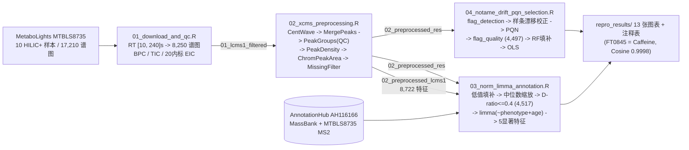

### 3.2 一键运行指南

```powershell
# 1. 仅体检依赖（确认 CRAN/Bioconductor/MsIO 全部就绪，不触发安装）
Rscript reproduction/metabolomics/Metabonaut/envs/install_packages.R --profile metabonaut --dry-run

# 2. 极速冒烟验证（< 10 秒：校验 QC RSD <= 30% + Pareto-PCA）
Rscript reproduction/metabolomics/Metabonaut/repro_scripts/run_all.R --mode smoke

# 3. 运行全流程复现 (Step 01 -> Step 02 -> Step 03 -> Step 04)
Rscript reproduction/metabolomics/Metabonaut/repro_scripts/run_all.R --mode full
```

---

## 4. 复现问题定位与工程解决方法

| 编号 | 卡点与现象 / 报错原因 | 根因分析 | 工程解决方法 |
|---|---|---|---|
| **Bug-1** | 独立运行 Step 01 时调用 `fData(eic_is)` 报 `could not find function "fData"` | 原著 `.qmd` 文档运行环境隐式通过其他元包导出 `fData()`，精简独立脚本后作用域丢失 | 在 `01_metabonaut_download_and_qc.R` 显式引入 `library(Biobase)` |
| **Bug-2** | 读取 `02_preprocessed_res` 后执行 `sweep(assay(res, ...), "/")` 或 `DratioFilter` 报错 `DelayedMatrix` 不支持算子 | `alabaster.se::readObject()` 默认以磁盘延迟矩阵 `DelayedMatrix` 载入 HDF5 assay | 读回后立即执行 `assay(res, aname) <- as.matrix(assay(res, aname))` 转为内存标准矩阵 |
| **Bug-3** | 读取 `02_preprocessed_lcms1` 后调用 `featureArea()` / `featureChromatograms()` 报方法未定义 | `readMsObject(MsExperiment(), ...)` 若传入父类原型，对象会退化丢失 `chromPeaks` 与 `featureDefinitions` | 在 `03` 显式传入 `XcmsExperiment()` 作为原型重建完整 `xcms` 对象 |
| **Bug-4** | `MsIO` 在当前 Bioconductor 镜像不可直接获取导致包安装失败 | `MsIO` 处于 RforMassSpectrometry 活跃迭代期，未同步进入部分 Bioc 镜像主库 | `install_packages.R` 实现“优先 `BiocManager::install("MsIO")`，失败自动回退 `remotes::install_github("RforMassSpectrometry/MsIO")`” |
| **Bug-5** | Windows 平台下并行后端 `MulticoreParam` 报错且 `matchSpectra` 多核序列化 SQLite 句柄崩溃 | Windows 不支持 POSIX `fork()`，且 SQLite `CompDb` 连接不可跨进程直接序列化 | Step 01/02/04 统一做 `.Platform$OS.type` 检测切换 `SnowParam(2)`；Step 03 在执行 `matchSpectra` 前显式 `register(SerialParam())` |

---

## 5. 复现结果图画廊与量化验收

### 5.1 核心验收定量指标总表

| 流程阶段 | 核心验收指标 | 本机实测结果 | 输出产物 |
|---|---|---|---|
| **00 冒烟验证** | 模拟 QC 过滤与 Pareto-PCA 离散度 | `286/300` 特征通过 `QC RSD <= 30%`（剔除 14 噪声）；`PC1=21.9%`；QC 质心距 `0.27` | `00_smoke_qc_pca.png`、`00_smoke_verification_summary.tsv` |
| **01 数据与质控** | `MTBLS8735` 样本量与色谱裁切 | **10 样本**（3 CVD, 3 CTR, 4 QC）；原始 `17,210` 张 $\rightarrow$ `[10, 240] s` 裁切保留 **`8,250` 张谱图** | `01_bpc_raw_and_filtered.png`、`02_tic_similarity_heatmap.png`、`03_internal_standards_eic.png` |
| **02 `xcms` 预处理** | 峰检测 $\rightarrow$ 对齐 $\rightarrow$ 回填 $\rightarrow$ 过滤 | 检测精修 **`89,185` 峰**（合并 9,242）；**5,373** QC 锚点对齐（偏移 < 1s）；分组 **`9,068` 特征**；缺峰回填使缺失率 **`26.41% -> 5.16%`**（含回填总峰 `108,454`）；过滤保留 **`8,722` 特征** | `04_peak_detection_summary.png`、`05_rt_alignment_diagnostics.png`、`06_gap_filling_qc_correlation.png`、`02_xcms_preprocessing_stats.tsv` |
| **03 `limma` 与注释** | `D-ratio` + 差异模型 + MS1/MS2 | `D-ratio <= 0.4` 保留 **`4,517` 特征**；`limma` BH-FDR < 0.05 检出 **`5` 显著特征**；MassBank `AH116166` MS1 匹配 **22 条**；MS2 余弦匹配以 **Score = `0.9998`** 鉴定 **`FT0845` = Caffeine** (`RYYVLZVUVIJVGH-UHFFFAOYSA-N`) | `07_rla_before_after_norm.png`、`08_study_samples_pca.png`、`09_limma_pvals_and_volcano.png`、`10_caffeine_eic_and_ms2_mirror.png`、`03_ms2_massbank_annotations.tsv` |
| **04 `notame` 对比** | 样条漂移 + PQN + RF 填补 + OLS | 质量标记保留 **`4,497 / 8,722` 特征**；94% 完成样条漂移校正；RF 填补 OOB = **`0.006`**；Top 1 定位 **`FT0845`** | `11_notame_injection_lm.png`、`12_notame_boxplots_and_pca.png`、`13_notame_beeswarm_and_volcano.png`、`04_notame_flag_report.tsv` |

### 5.2 代表性复现图谱展示

1. **原始谱图 BPC 裁切、TIC 聚类与同位素内标 RT 漂移核查 (`Step 01`)**：

   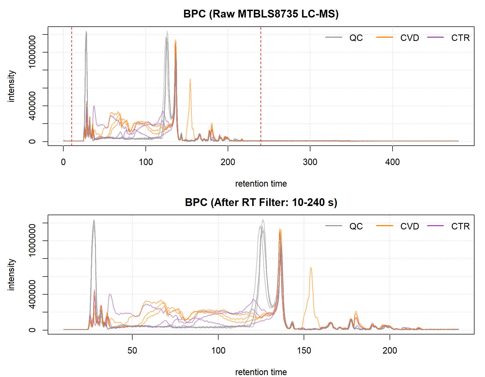
   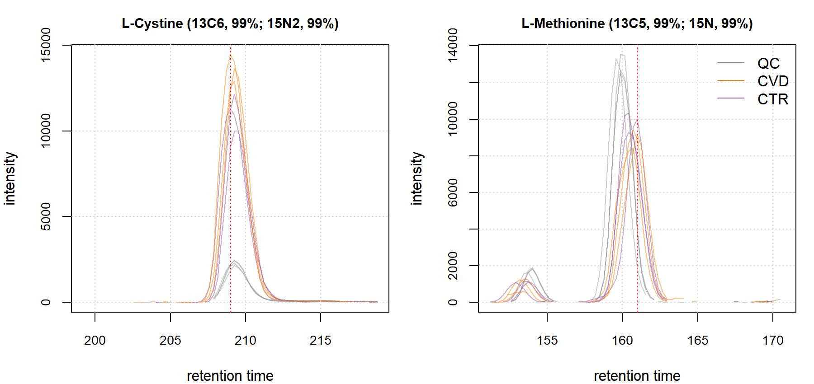

2. **`xcms v4` 峰检测特征分布、QC 锚点 RT 对齐与缺峰回填相关性 (`Step 02`)**：

   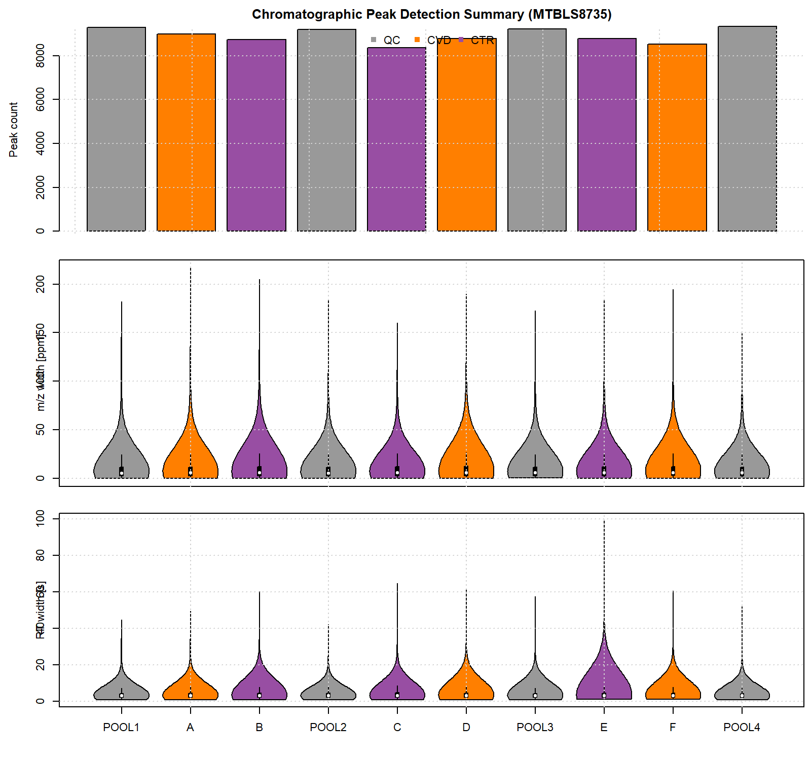
   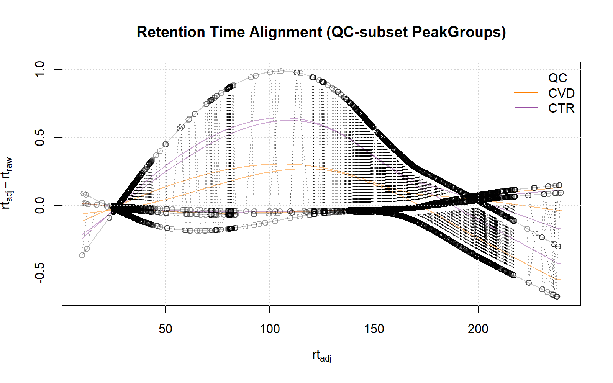
   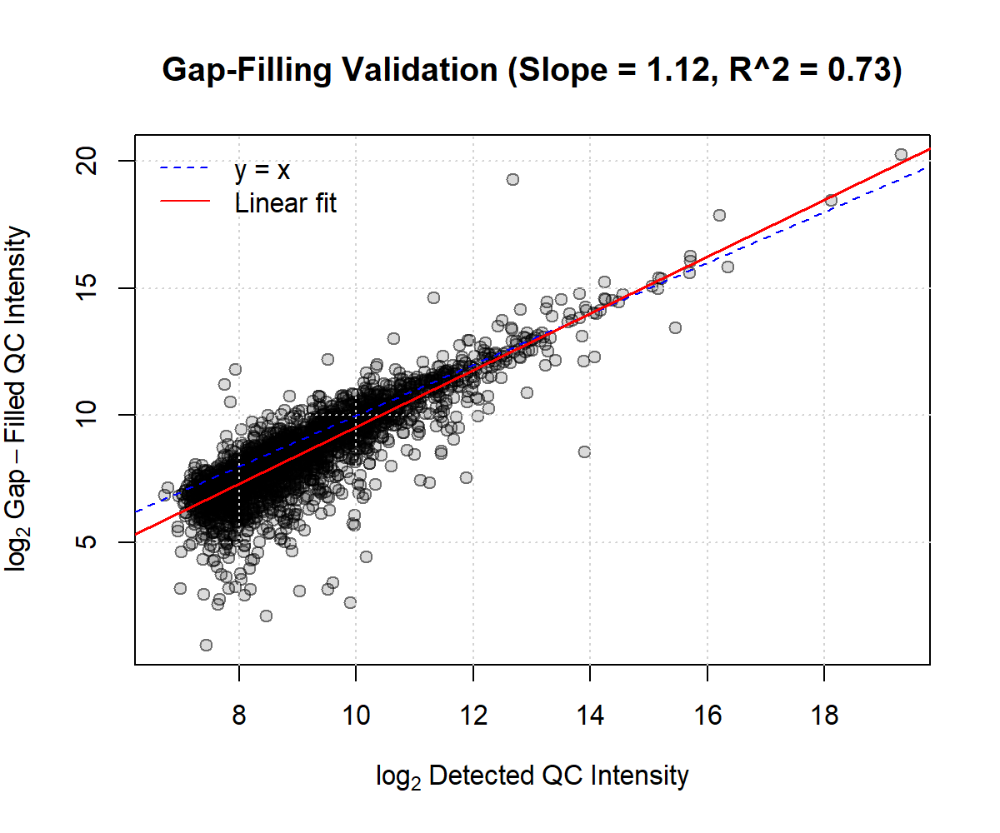

3. **中位数归一化 RLA、研究样本 PCA、`limma` 火山图与 Caffeine (`FT0845`) MS2 镜像匹配 (`Step 03`)**：

   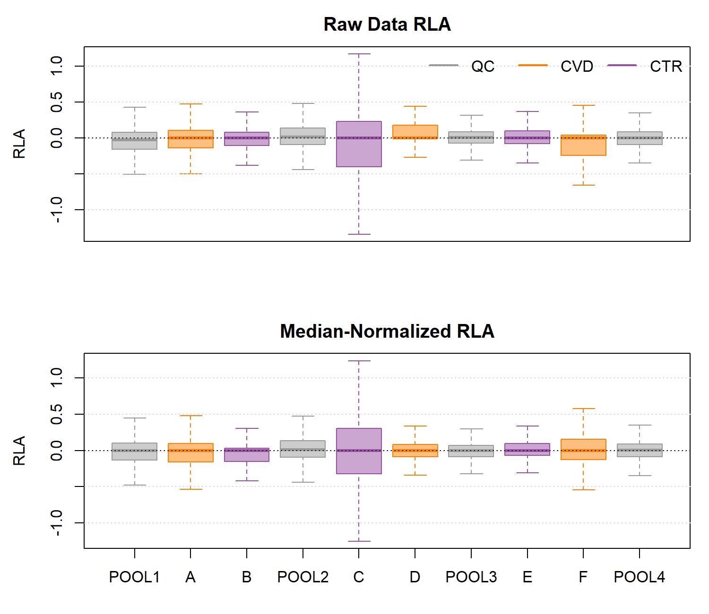
   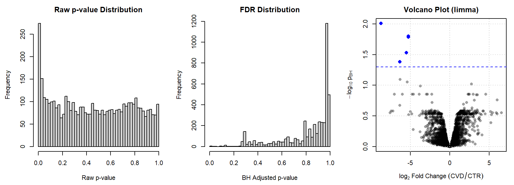
   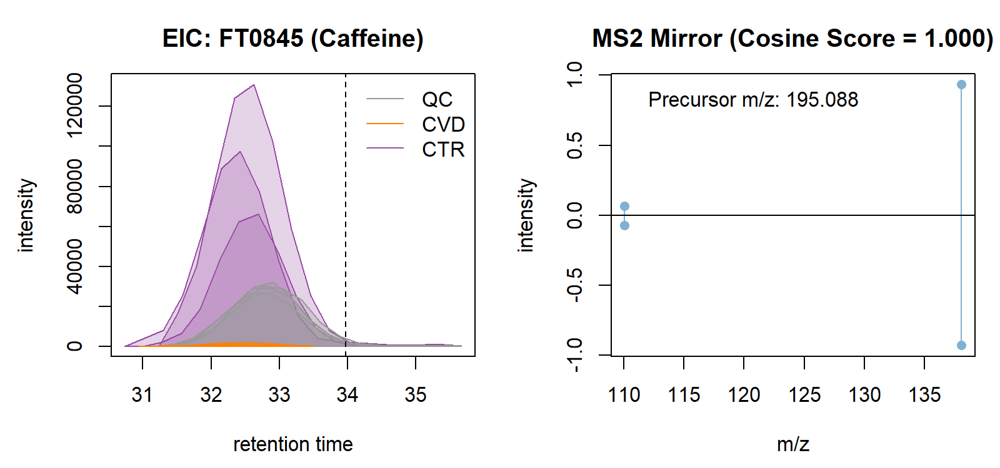

4. **`notame` 三次样条漂移校正前后 PCA、箱线图与 `FT0845` 蜂群对比 (`Step 04`)**：

   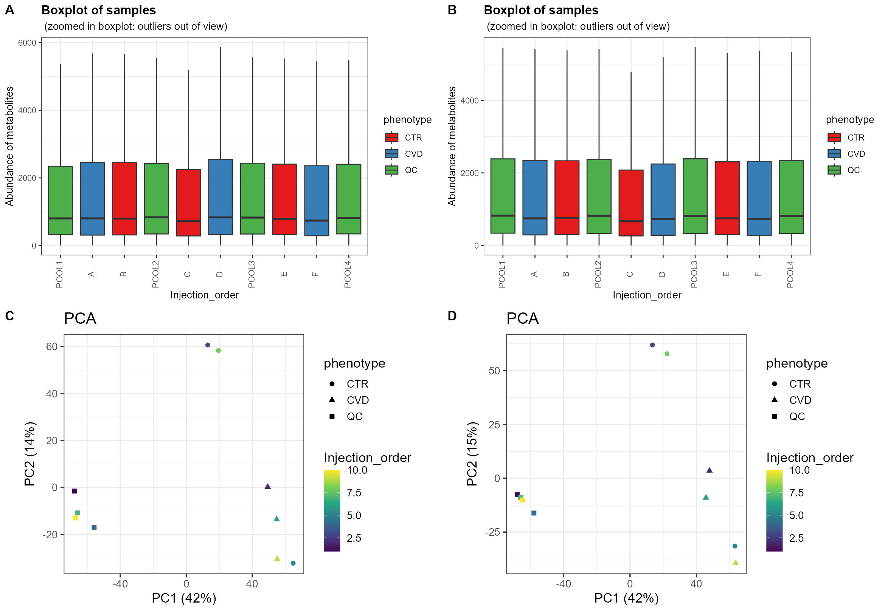
   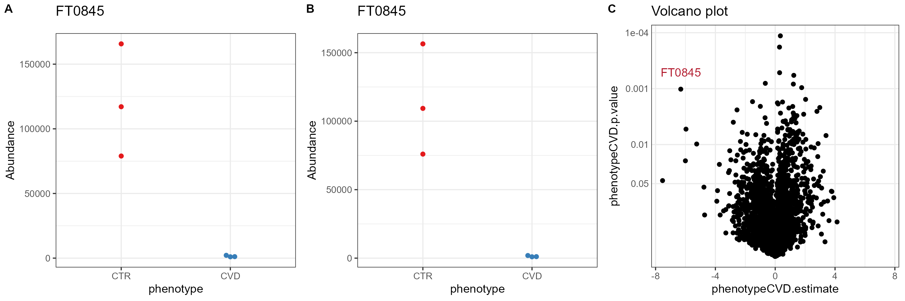

> 其他完整图表（`00_smoke_qc_pca.png`、`02_tic_similarity_heatmap.png`、`08_study_samples_pca.png`、`11_notame_injection_lm.png`）及统计 TSV 均已保存在 [`repro_results/`](./repro_results/) 目录。

---

## 6. 运行环境与工具软件包清单

以下软件与精确版本同步记录于 [repro_results/environment_versions.tsv](./repro_results/environment_versions.tsv) 与 [logs/sessionInfo.txt](./logs/sessionInfo.txt)：

| 类别 | 软件包 | 实测版本 | 来源仓库 | 在本复现工程中的职能 |
|---|---|---|---|---|
| **核心语言** | `R` | `4.6.0` | Base R | Windows x64 运行时 |
| **质谱框架** | `MsExperiment` | `1.14.0` | Bioconductor 3.23 | 统一管理样本元数据与 LC-MS 谱图索引容器 |
| | `MsIO` | `0.0.17` | GitHub / Bioc | 通过 `MetaboLightsParam` & `AlabasterParam` 读写实验对象 |
| | `MsBackendMetaboLights` | `1.6.1` | Bioconductor 3.23 | 自动从 EBI MetaboLights API 按需拉取并缓存 `.mzML` |
| | `xcms` | `4.10.1` | Bioconductor 3.23 | CentWave 寻峰、裂分峰合并、PeakGroups 对齐、分组与缺峰回填 |
| | `Spectra` / `MetaboCoreUtils` | `1.22.2` / `1.20.1` | Bioconductor 3.23 | MS2 去噪、强度缩放、峰范围切片与镜像对比 |
| | `MsBackendMgf` / `MsBackendMassbank` | `1.20.1` / `1.20.0` | Bioconductor 3.23 | MGF/MassBank 公共谱图库解析后端 |
| **对象序列化** | `SummarizedExperiment` / `alabaster.se` | `1.42.0` / `1.12.0` | Bioconductor 3.23 | 定量矩阵容器及 HDF5/JSON 跨版本无损存取 |
| | `Biobase` / `BiocParallel` / `BiocManager` | `2.72.0` / `1.46.0` / `1.30.27` | Bioc / CRAN | 提供 `fData()` 方法及跨平台 `SnowParam`/`MulticoreParam` 并行 |
| **注释数据库** | `MetaboAnnotation` / `CompoundDb` / `AnnotationHub` | `1.16.0` / `1.16.0` / `4.2.2` | Bioconductor 3.23 | MassBank `AH116166` SQLite 加载、MS1 加合匹配与 MS2 余弦匹配 |
| **统计与 `notame`** | `limma` | `3.68.5` | Bioconductor 3.23 | 经验贝叶斯线性模型差异分析 (`~ phenotype + age`) |
| | `notame` / `notameStats` / `notameViz` | `1.2.0` | Bioconductor 3.23 | 检出率标记、三次样条漂移校正、PQN、RF 填补与蜂群图 |
| **通用与绘图** | `tidyverse` / `data.table` / `matrixStats` | `2.0.0` / `1.18.6.1` / `1.5.0` | CRAN | 矩阵数值运算与表格整合 |
| | `ggplot2` / `patchwork` / `pheatmap` / `ggfortify` / `vioplot` / `gridExtra` / `RColorBrewer` / `cowplot` | `4.0.3` / `1.3.2` / `1.0.13` / `0.4.25` / `0.5.1` / `2.3.1` / `1.1.3` / `1.2.0` | CRAN | 全流程多联质控图、热图、PCA、提琴图与火山图排布 |
